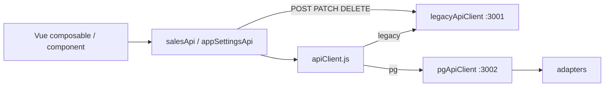

# Phase 1-4 Vue Feature Flag PG API 연동

## 1. 목적

Vue 프론트엔드에서 **기존 SQLite API(`:3001`)** 와 **신규 PostgreSQL 읽기 API(`:3002`)** 를 feature flag로 선택 전환할 수 있게 합니다.

- 기본값은 반드시 `legacy` (SQLite)
- 이번 단계는 **읽기 API 일부만** PG로 연동
- 업로드·파싱·export·KPI 전체 계산·수기 저장은 legacy 유지

## 2. API 모드 구조

```text
src/services/apiMode.js          — VITE_API_MODE 해석 (legacy | pg)
src/services/legacyApiClient.js  — :3001 직접 호출
src/services/pgApiClient.js      — :3002 /api/v1 호출 + 페이징 순회
src/services/apiClient.js        — 읽기 API 모드 분기
src/services/salesApi.js         — 쓰기는 항상 legacy, 읽기는 apiClient 위임
src/services/appSettingsApi.js   — 조회 분기, 저장은 legacy
src/services/adapters/*.js       — PG 응답 → Vue 기대 형식
```

분기 흐름:



## 3. 환경변수 설정

`.env` 또는 `.env.local` 예시:

```env
VITE_API_MODE=legacy
VITE_LEGACY_API_BASE=http://localhost:3001/api
VITE_PG_API_BASE=http://localhost:3002/api/v1
```

| 변수 | 허용값 | 기본 |
|------|--------|------|
| `VITE_API_MODE` | `legacy`, `pg` | `legacy` |
| `VITE_LEGACY_API_BASE` | URL | `http://localhost:3001/api` |
| `VITE_PG_API_BASE` | URL | `http://localhost:3002/api/v1` |

Vite는 빌드/실행 시점에 env를 고정합니다. 모드 변경 후 **dev 서버 재시작**이 필요합니다.

## 4. legacy 모드 실행 방법

1. SQLite legacy API 실행: `npm run dev:server` (또는 `npm run dev`)
2. `.env`에 `VITE_API_MODE=legacy` 확인
3. Vue 실행: `npm run dev:client` (또는 `npm run dev`)
4. 브라우저 `http://localhost:5173` — 개발 시 헤더에 `API MODE: LEGACY` 배지 표시

## 5. pg 모드 실행 방법

1. PostgreSQL + API 컨테이너: `docker compose up -d db api`
2. 데이터 이전 완료 확인: `npm run verify:pg`
3. `.env`에서 `VITE_API_MODE=pg` 로 변경 후 Vue 재시작
4. 브라우저 `http://localhost:5173` — `API MODE: PG` 배지, Network 탭에서 `:3002` 호출 확인

## 6. 연동된 화면/기능

| 기능 | legacy | pg | 비고 |
|------|--------|-----|------|
| 업로드 이력 목록 | `GET /api/uploads` | `GET /api/v1/uploads` | 전 페이지 순회 |
| 판매 records 조회 | `GET /api/records?recordType=` | `GET /api/v1/records?record_type=` | `include_data=true`, 페이징 순회 |
| settings 조회 | `GET /api/settings/:scope/:kind` | `GET /api/v1/settings?scope=&kind=` | hydrate 시 사용 |
| 기본 KPI summary API | (클라이언트 집계) | `GET /api/v1/kpi/summary` | `fetchKpiSummary()` — 대시보드 KPI는 records 기반 클라이언트 계산 유지 |

영향 화면 (service 경유, 컴포넌트 직접 수정 없음):

- 플랫폼 업로드 — 업로드 이력
- 매출 대시보드 — records·KPI·필터
- 통합 매출 데이터 — records 표시
- 설정 패널 — staff memo, manual ad, power price 등 settings hydrate

## 7. 아직 legacy 유지 중인 기능

- 엑셀 업로드 (`POST /api/uploads/*`)
- 엑셀 파싱 (클라이언트 `src/utils/*Parser`)
- record 수정/삭제 (`PATCH`/`DELETE /api/records`)
- 업로드 배치 삭제 (`DELETE /api/uploads/:id`)
- settings 저장 (`PUT /api/settings/...`)
- KPI 전체 계산 (`esserMetrics`, `platformKpiSplit` 등 클라이언트)
- 통합/대시보드 엑셀 export (`dashboardExporter` 등)
- 수기 입력 저장 (power price, coupang 1p, own mall manual 등)

## 8. 응답 adapter 구조

### `recordsAdapter.js`

PG `items[]` → legacy `rowToRecord` 호환:

- `id`, `uploadId`, `recordType`, `createdAt`, `updatedAt`
- `date` (data.date → order_date → business_date)
- `platform`, `channel`, `salesMethod`, `brand`/`storeName`
- `productCode`, `productName`, `option`
- `sales`, `salesQty`, `netProfit`, `adSpend`
- `transactionType`, `uploadKind`, `uploadFormat`, `sourceFileName`
- JSONB `data` 필드 병합 (`...data`)

### `uploadsAdapter.js`

- `fileName`, `platform`, `uploadKind`, `businessDate`
- `detailCount`, `dailyCount`, `channelCount`, `productCount`, `productOptionCount`, `totalCount`
- `salesMethod`, `createdAt`

### `settingsAdapter.js`

- `{ ok: true, data, updatedAt }` (legacy 단건 응답 형식)

### `kpiAdapter.js`

- `salesTotal`, `quantityTotal`, `recordCount`, `uploadCount`, `filters`

## 9. 검증 체크리스트

### 공통

- [ ] `import.meta.env.DEV` 일 때만 `API MODE: LEGACY|PG` 배지 표시
- [ ] env 미설정 시 `legacy` 동작
- [ ] 쓰기 작업(업로드·저장·삭제)은 pg 모드에서도 `:3001` 호출

### Legacy 모드 (`VITE_API_MODE=legacy`)

- [ ] `npm run dev` — Vue `:5173` 정상
- [ ] Network: `localhost:3001/api/uploads`, `/records`, `/settings` 호출
- [ ] 업로드 이력 테이블 정상
- [ ] 대시보드 KPI·상세 표 정상
- [ ] settings 패널 로드 정상

### PG 모드 (`VITE_API_MODE=pg`)

- [ ] `docker compose up -d api` — `:3002` health OK
- [ ] Network: `localhost:3002/api/v1/uploads`, `/records`, `/settings` 호출
- [ ] 업로드 목록 건수 ≈ legacy (153건 기준)
- [ ] detail records 로드 후 대시보드 KPI 표시
- [ ] `curl http://localhost:3002/api/v1/kpi/summary` — sales/qty 합계 일치
- [ ] settings scope/kind 조회 성공

### 비교 (선택)

```bash
npm run compare:read-api
```

SQLite vs PG 읽기 API 수치 일치 확인 (Phase 1-3 스크립트).

### 빌드

```bash
# PowerShell
$env:VITE_API_MODE="legacy"; npm run build
$env:VITE_API_MODE="pg"; npm run build
```

## 10. 발견된 이슈

| 이슈 | 영향 | 대응 |
|------|------|------|
| PG records는 페이징 API | 대량 조회 시 다중 요청 | `pgApiClient`에서 limit=500 순회 |
| PG 기본 목록은 JSONB `data` 제외 | 상세 필드 누락 가능 | records 조회 시 `include_data=true` |
| daily/channel/product 탭 | PG에 해당 record_type 데이터 없을 수 있음 | SQLite 이전 데이터는 detail 위주 — 탭은 빈 목록 가능 |
| KPI 대시보드 | 서버 summary 미사용 | records 기반 클라이언트 KPI 유지 (Phase 1-5 후보) |

## 11. Phase 1-5 제안

1. PG 모드 기본값 전환 검토 (`VITE_API_MODE=pg` 프로덕션 플래그)
2. `fetchKpiSummary`를 대시보드 검증/디버그 패널에 연동
3. KPI `platform-split` 백엔드 포팅 후 클라이언트 계산 일부 이전
4. settings 저장·업로드 API PG 쓰기 이전 (Phase 2+)
5. nginx 단일 진입점으로 legacy/pg 프록시 통합
6. E2E 자동 비교 (legacy vs pg 스크린샷/수치 diff)
