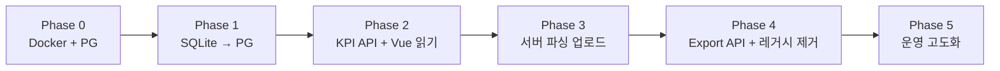

# essersales 목표 아키텍처 (Target Architecture)

> Vue SPA 유지 + 백엔드 API + PostgreSQL + Docker Compose  
> 엑셀 파싱·정규화·KPI·통합 엑셀 생성은 **백엔드 전담**, Vue는 **UI·표시·입력**만 담당  
> 설계 문서 (코드 미구현 · 2026-06 기준)  
> 선행 문서: [`current-structure.md`](./current-structure.md)

---

## 1. 목표 요약

| 구분 | 현재 | 목표 |
|------|------|------|
| 프론트 | Vue + 브라우저 파싱/KPI/엑셀 | Vue — 화면·업로드 UI·수기입력·대시보드 **표시만** |
| API | Express + SQLite (JSON 저장 위주) | **독립 백엔드** — 파싱·집계·export |
| DB | `essersales.db` (SQLite, JSON blob) | **PostgreSQL** — 정규 컬럼 + JSONB 하이브리드 |
| 배포 | `npm run preview` 단일 Node | **Docker Compose** (web + api + db + nginx) |
| NAS | 수동 복사·실행 | Compose 스택 + 볼륨 백업 |

### 1.1 책임 분리 원칙

```
┌─────────────────────────────────────────────────────────────┐
│  Vue (frontend)                                              │
│  · 탭·필터·차트·테이블 렌더링                                  │
│  · multipart 파일 선택 → API 업로드                           │
│  · 수기입력 폼 → API 저장                                     │
│  · KPI/차트 데이터는 API 응답을 그대로 표시 (재계산 없음)      │
│  · 엑셀 다운로드 = API 스트림 → Blob 저장                     │
└───────────────────────────┬─────────────────────────────────┘
                            │ HTTP (JSON / multipart / file)
┌───────────────────────────▼─────────────────────────────────┐
│  Backend API (Node.js 권장)                                    │
│  · Excel 파싱 (기존 src/utils/*Parser 이전)                    │
│  · 데이터 정규화·플랫폼/판매방식 해석                           │
│  · KPI·전일대비·세그먼트 집계                                   │
│  · 통합 손익 엑셀 생성 (ExcelJS)                                │
│  · 원본 파일 보관 (NAS 볼륨)                                    │
└───────────────────────────┬─────────────────────────────────┘
                            │
┌───────────────────────────▼─────────────────────────────────┐
│  PostgreSQL                                                  │
│  · 업로드 메타·정규화된 판매 레코드·수기입력·설정               │
└─────────────────────────────────────────────────────────────┘
```

**백엔드 언어 선택:** 기존 `platformKpiSplit.js`, `dashboardExporter.js` 등 **약 1만 줄 이상의 JS 도메인 로직**이 있으므로 1차 목표는 **Node.js (Express/Fastify)** 로 이전·재사용하는 것을 권장한다. Python(FastAPI) 전환은 Phase 5 이후 선택 과제로 둔다.

---

## 2. 신규 폴더 구조

기존 Vue 앱을 **최대한 유지**하면서 점진적으로 `backend/`를 추가하는 **모노레포** 구조.

```
essersales/
├── docker-compose.yml              # 개발·NAS 공통 (profile로 dev/prod 분기)
├── docker-compose.override.yml     # 로컬 개발 전용 (gitignore 가능)
├── .env.example
├── Makefile                        # up / migrate / backup 단축 명령 (선택)
│
├── frontend/                       # 기존 src/·vite — 점진 이전 또는 루트 유지
│   ├── package.json
│   ├── vite.config.js
│   ├── Dockerfile                  # multi-stage: build → nginx 정적 서빙
│   ├── nginx.conf                  # SPA fallback, /api 프록시
│   └── src/
│       ├── App.vue
│       ├── components/             # UI만 (파서·KPI·export 제거 대상)
│       ├── composables/            # API 호출·로컬 UI 상태만
│       ├── services/
│       │   ├── apiClient.js        # 공통 fetch, 에러, 인증 헤더
│       │   ├── uploadApi.js
│       │   ├── kpiApi.js
│       │   ├── recordsApi.js
│       │   ├── exportApi.js
│       │   └── settingsApi.js
│       └── config/                 # UI 라벨·탭 정의 (순수 표시용)
│
├── backend/
│   ├── package.json
│   ├── Dockerfile
│   ├── src/
│   │   ├── index.js                # HTTP 서버 진입
│   │   ├── app.js                  # Express/Fastify 앱 조립
│   │   ├── config/
│   │   │   ├── env.js
│   │   │   └── channels.js         # dataChannels 이전 (서버 단일 소스)
│   │   ├── routes/
│   │   │   ├── health.js
│   │   │   ├── uploads.js
│   │   │   ├── records.js
│   │   │   ├── kpi.js
│   │   │   ├── export.js
│   │   │   └── settings.js
│   │   ├── controllers/            # 요청 검증·응답 매핑
│   │   ├── services/
│   │   │   ├── uploadService.js
│   │   │   ├── parseService.js
│   │   │   ├── normalizeService.js
│   │   │   ├── kpiService.js
│   │   │   ├── exportService.js
│   │   │   └── settingsService.js
│   │   ├── domain/                 # 기존 src/utils 이전 (순수 함수)
│   │   │   ├── parsers/
│   │   │   │   ├── platformOrderParser.js
│   │   │   │   ├── salesReportParser.js
│   │   │   │   ├── coupangEsserParser.js
│   │   │   │   ├── ownMallSalesParser.js
│   │   │   │   └── naverAdCenterParser.js
│   │   │   ├── kpi/
│   │   │   │   ├── esserMetrics.js
│   │   │   │   ├── platformKpiSplit.js
│   │   │   │   ├── manualAdSpend.js
│   │   │   │   └── dayOverDaySales.js
│   │   │   ├── export/
│   │   │   │   ├── dashboardExporter.js
│   │   │   │   ├── profitLossReportExporter.js
│   │   │   │   └── excelWorkbookStyle.js
│   │   │   └── normalize/
│   │   │       ├── recordFields.js
│   │   │       ├── platformResolve.js
│   │   │       └── salesMethodDetect.js
│   │   ├── db/
│   │   │   ├── pool.js             # pg Pool
│   │   │   ├── migrations/         # 순번 SQL
│   │   │   └── repositories/       # 테이블별 쿼리
│   │   └── jobs/                   # (선택) 대용량 export 비동기 큐
│   │       └── exportWorker.js
│   └── storage/                    # 로컬 dev용 업로드 원본 (NAS에서는 볼륨 마운트)
│
├── packages/                       # (선택) 프론트·백 공유 타입·상수
│   └── shared/
│       ├── scopes.json
│       └── api-types.d.ts
│
├── infra/
│   ├── nginx/
│   │   └── default.conf            # NAS 리버스 프록시
│   ├── postgres/
│   │   └── init.sql                # 확장·롤 생성 (선택)
│   └── scripts/
│       ├── migrate-sqlite-to-pg.mjs
│       ├── backup-db.sh
│       └── backup-uploads.sh
│
├── server/                         # ⚠ 레거시 — Phase 4까지 병행 후 제거
├── src/                            # ⚠ Phase 0~2: 루트 유지 가능, Phase 3에서 frontend/로 이동
├── scripts/                        # 운영·마이그레이션 스크립트
└── docs/
    ├── current-structure.md
    └── target-architecture.md      # 본 문서
```

### 2.1 이전 대상 파일 매핑 (요약)

| 현재 (`src/utils/`) | 목표 (`backend/src/domain/`) | Vue에서 제거 |
|---------------------|---------------------------|-------------|
| `*Parser.js`, `excelReader.js` | `domain/parsers/` | ✅ |
| `esserMetrics.js`, `platformKpiSplit.js` 등 | `domain/kpi/` | ✅ |
| `dashboardExporter.js` 등 | `domain/export/` | ✅ |
| `recordFilters.js` (서버 필터) | `services/` + SQL | 부분 |
| `formatDisplay.js` | `frontend/src/utils/` | ❌ 유지 |
| `config/dataChannels.js` | `packages/shared` 또는 backend `config/` | UI용 복사본만 |

---

## 3. 목표 데이터 흐름

```
[사용자] Excel 파일 선택 (Vue ExcelUpload.vue)
        │
        ▼  multipart/form-data
POST /api/v1/uploads/platform-daily  (file + metadata)
        │
        ▼
Backend: 저장 → 파싱 → 정규화 → PostgreSQL INSERT
        │
        ▼
응답: { uploadId, counts, previewRows[] }

[대시보드] 필터 변경 (Vue DatePeriodFilter)
        │
        ▼
GET /api/v1/kpi/summary?scope=combined_daily&dateFrom=...&dateTo=...
GET /api/v1/kpi/platform-split?...
GET /api/v1/kpi/chart-buckets?granularity=daily
        │
        ▼
Vue: 차트·KPI 카드에 응답 바인딩 (클라이언트 집계 없음)

[엑셀 다운로드] 버튼
        │
        ▼
POST /api/v1/exports/dashboard  (JSON body: scope, filters, options)
        │
        ▼
Backend: 동일 domain/export 로직 → application/vnd.openxmlformats...
        │
        ▼
Vue: response.blob() → 다운로드
```

---

## 4. API 구조

Base path: `/api/v1`  
인증: Phase 1~3는 **내부망 신뢰** (NAS VPN/LAN). Phase 4에서 API Key 또는 세션 인증 추가.

### 4.1 공통 규약

| 항목 | 규칙 |
|------|------|
| Content-Type | JSON 기본; 업로드는 `multipart/form-data` |
| 날짜 | ISO `YYYY-MM-DD`, 월별 `YYYY-MM` |
| scope | `platform`, `company_b`, `combined_daily`, `power_price` 등 기존과 동일 |
| 페이징 | `?limit=100&cursor=` 또는 `offset` |
| 에러 | `{ "error": { "code": "...", "message": "..." } }` |
| 버전 | `GET /api/v1/health` → `{ apiVersion, features, dbOk }` |

### 4.2 엔드포인트 목록

#### Health

| Method | Path | 설명 |
|--------|------|------|
| GET | `/api/v1/health` | DB 연결·마이그레이션 버전·기능 플래그 |

#### Uploads (파일 → 서버 파싱)

| Method | Path | 설명 |
|--------|------|------|
| GET | `/api/v1/uploads` | 업로드 이력 (`?scope=&uploadKind=`) |
| GET | `/api/v1/uploads/:id` | 메타 + 파싱 요약 |
| DELETE | `/api/v1/uploads/:id` | 업로드·연관 레코드·원본 파일 삭제 |
| POST | `/api/v1/uploads/platform-daily` | multipart: `file`, `platform`, `salesMethod?` |
| POST | `/api/v1/uploads/platform-monthly` | multipart: `file`, `platform`, `periodFrom`, `periodTo` |
| POST | `/api/v1/uploads/sales-report` | multipart: `file` |
| POST | `/api/v1/uploads/own-mall-sales` | multipart: `file` (자사몰 판매) |
| POST | `/api/v1/uploads/own-mall-catalog` | multipart: `file` |
| POST | `/api/v1/uploads/naver-ad` | multipart: `file`, `scope` |
| POST | `/api/v1/uploads/:id/reparse` | (선택) 저장된 원본 재파싱 |

**변경점:** 클라이언트가 `details[]` JSON을 보내지 않음. 서버가 파일을 읽고 파싱한다.

#### Records (조회·수정)

| Method | Path | 설명 |
|--------|------|------|
| GET | `/api/v1/records` | 필터·페이징 (`scope`, `recordType`, `dateFrom`, `dateTo`, `platform`, `uploadIds`) |
| GET | `/api/v1/records/:id` | 단건 |
| PATCH | `/api/v1/records/:id` | 수동 보정 (기존과 동일) |
| DELETE | `/api/v1/records/:id` | 단건 삭제 |

#### KPI & Dashboard

| Method | Path | 설명 |
|--------|------|------|
| GET | `/api/v1/kpi/summary` | Esser KPI 카드 (`summarizeEsserKpisWithManual` 대체) |
| GET | `/api/v1/kpi/platform-split` | 플랫폼·세그먼트 KPI 표 |
| GET | `/api/v1/kpi/day-over-day` | 전일/전주 대비 |
| GET | `/api/v1/kpi/chart-buckets` | 일/주/월 차트 시리즈 |
| GET | `/api/v1/dashboard/tabs` | 요약·일별·채널·상품 탭 데이터 (통합 리포트용) |

Query 예시:

```
GET /api/v1/kpi/summary?scope=combined_daily&dateFrom=2026-06-01&dateTo=2026-06-28
    &platform=&salesMethod=&uploadIds=uuid1,uuid2
```

#### Settings (수기입력)

| Method | Path | 설명 |
|--------|------|------|
| GET | `/api/v1/settings/:scope/:kind` | 조회 |
| PUT | `/api/v1/settings/:scope/:kind` | 저장 |
| POST | `/api/v1/settings/:scope/manual-ad/parse` | (선택) 광고 엑셀만 파싱 미리보기 |

**kind:** `manual_ad`, `power_price`, `coupang_1p_rocket`, `own_mall_manual`, `special_sale`, `staff_memo`, `combined_comments`, `profit_loss_template`

수기입력 저장 시 백엔드가 **가상 detail 레코드 뷰**를 KPI API에 자동 반영 (DB materialized view 또는 런타임 merge — Phase 2에서 결정).

#### Export

| Method | Path | 설명 |
|--------|------|------|
| POST | `/api/v1/exports/dashboard` | 통합/채널 매출 리포트 엑셀 (본문 JSON) |
| POST | `/api/v1/exports/table` | 현재 탭 표만 (가벼운 export, 서버 또는 클라이언트 유지 가능) |
| GET | `/api/v1/exports/jobs/:id` | (선택) 비동기 export 상태 |
| GET | `/api/v1/exports/jobs/:id/download` | (선택) 완료 파일 다운로드 |

`POST /exports/dashboard` 요청 본문 예시:

```json
{
  "scope": "combined_daily",
  "filters": {
    "dateFrom": "2026-06-01",
    "dateTo": "2026-06-28",
    "platform": "",
    "salesMethod": "",
    "period": "daily"
  },
  "selectedUploadIds": ["..."],
  "options": {
    "includeProfitLossTemplate": true,
    "layoutVersion": 31
  }
}
```

응답: `200` + `Content-Disposition: attachment` 또는 `202` + `jobId` (대용량).

### 4.3 레거시 API 호환 (과도기)

Phase 2까지 `server/index.js` (SQLite)와 `backend/` (PostgreSQL) **병행** 시:

| 레거시 | 신규 | 비고 |
|--------|------|------|
| `POST /api/uploads/platform-daily` (JSON) | `POST /api/v1/uploads/platform-daily` (multipart) | Vue feature flag |
| `GET /api/records` | `GET /api/v1/records` | 필터·페이징 추가 |
| `GET /api/settings/...` | `GET /api/v1/settings/...` | 동일 |

`VITE_API_VERSION=v1` 환경 변수로 클라이언트 분기.

---

## 5. PostgreSQL 스키마

SQLite의 JSON blob 중심에서 **조회·집계에 필요한 컬럼을 정규화**하고, 나머지는 `JSONB`로 보관하는 하이브리드 모델.

### 5.1 ER 개요

```
uploads 1 ── * sales_records
uploads 1 ── 1 upload_files (원본 바이너리 경로)

app_settings (scope, kind) — JSONB document store (기존 호환)

manual_ad_entries      — (선택) 정규화
power_price_entries
coupang_1p_rocket_entries
own_mall_manual_state
```

### 5.2 테이블 정의

#### `uploads`

| 컬럼 | 타입 | 설명 |
|------|------|------|
| id | UUID PK | |
| file_name | TEXT NOT NULL | 원본 파일명 |
| storage_path | TEXT | NAS 볼륨 내 상대 경로 |
| platform | TEXT | 쿠팡, 네이버… |
| sales_method | TEXT | |
| upload_kind | TEXT NOT NULL | `platform_daily`, `platform_monthly`, `sales_report`, … |
| business_date | DATE | 일별 기준일 |
| period_from | DATE | 월별·기간 |
| period_to | DATE | |
| detail_count | INT | |
| daily_count | INT | |
| channel_count | INT | |
| product_count | INT | |
| product_option_count | INT | |
| parse_status | TEXT | `pending`, `ok`, `failed` |
| parse_error | TEXT | |
| created_at | TIMESTAMPTZ | |

인덱스: `(upload_kind, created_at DESC)`, `(platform, business_date)`.

#### `upload_files`

| 컬럼 | 타입 | 설명 |
|------|------|------|
| upload_id | UUID PK FK → uploads | |
| sha256 | TEXT | 중복 검사 |
| size_bytes | BIGINT | |
| mime_type | TEXT | |
| stored_at | TIMESTAMPTZ | |

#### `sales_records`

핵심 집계·필터 컬럼 + 전체 행 JSONB.

| 컬럼 | 타입 | 설명 |
|------|------|------|
| id | UUID PK | |
| upload_id | UUID FK → uploads ON DELETE CASCADE | |
| record_type | TEXT NOT NULL | `detail`, `daily`, `channel`, `product`, `productOption` |
| order_date | DATE | 상세 행 기준일 (nullable) |
| platform | TEXT | |
| sales_method | TEXT | |
| channel | TEXT | |
| store_name | TEXT | |
| product_name | TEXT | |
| sales | NUMERIC(18,2) | 정규화 매출 |
| sales_qty | NUMERIC(18,4) | |
| net_profit | NUMERIC(18,2) | |
| ad_spend | NUMERIC(18,2) | |
| data | JSONB NOT NULL | Esser 원본 필드 전체 |
| created_at | TIMESTAMPTZ | |
| updated_at | TIMESTAMPTZ | |

인덱스:

- `(record_type, order_date)` — 기간 필터
- `(upload_id)`
- `(platform, sales_method, order_date)` — KPI 세그먼트
- `GIN (data)` — (선택) JSONB 검색

**마이그레이션 시:** SQLite `data` JSON을 파싱해 `order_date`, `sales` 등 컬럼 backfill.

#### `app_settings`

| 컬럼 | 타입 | 설명 |
|------|------|------|
| scope | TEXT | |
| kind | TEXT | |
| data | JSONB NOT NULL | |
| updated_at | TIMESTAMPTZ | |
| PK | (scope, kind) | |

기존 `ALLOWED_SCOPES`, `ALLOWED_KINDS` 그대로 유지.

#### `schema_migrations`

| 컬럼 | 타입 |
|------|------|
| version | INT PK |
| name | TEXT |
| applied_at | TIMESTAMPTZ |

#### (선택 Phase 3+) `export_jobs`

| 컬럼 | 타입 | 설명 |
|------|------|------|
| id | UUID PK | |
| scope | TEXT | |
| status | TEXT | `queued`, `running`, `done`, `failed` |
| file_path | TEXT | |
| created_at | TIMESTAMPTZ | |
| expires_at | TIMESTAMPTZ | |

### 5.3 뷰·머티리얼라이즈드 뷰 (Phase 3)

수기입력을 매번 JSON merge하지 않도록:

```sql
-- 예: 통합 daily detail 통합 뷰
CREATE VIEW v_combined_detail AS
  SELECT ... FROM sales_records WHERE ...
  UNION ALL
  SELECT ... FROM power_price_virtual ...  -- app_settings 기반 함수
```

초기에는 **서비스 레이어 런타임 merge** (기존 `useSalesData` 로직 이전)로 시작하고, 성능 측정 후 MV 도입.

---

## 6. Docker Compose 구조

### 6.1 서비스 구성

```yaml
# docker-compose.yml (개념도)
services:
  db:
    image: postgres:16-alpine
    environment:
      POSTGRES_DB: essersales
      POSTGRES_USER: essersales
      POSTGRES_PASSWORD: ${POSTGRES_PASSWORD}
    volumes:
      - pgdata:/var/lib/postgresql/data
    healthcheck:
      test: ["CMD-SHELL", "pg_isready -U essersales"]
      interval: 5s
      retries: 5

  api:
    build: ./backend
    environment:
      DATABASE_URL: postgres://essersales:${POSTGRES_PASSWORD}@db:5432/essersales
      UPLOAD_DIR: /data/uploads
      NODE_ENV: production
    volumes:
      - uploads:/data/uploads
    depends_on:
      db:
        condition: service_healthy
    expose:
      - "3001"

  web:
    build: ./frontend
    depends_on:
      - api
    expose:
      - "80"

  proxy:
    image: nginx:alpine
    ports:
      - "${HTTP_PORT:-8080}:80"
    volumes:
      - ./infra/nginx/default.conf:/etc/nginx/conf.d/default.conf:ro
    depends_on:
      - web
      - api

volumes:
  pgdata:
  uploads:
```

### 6.2 네트워크·라우팅

| 외부 경로 | 대상 | 설명 |
|-----------|------|------|
| `/` | `web:80` | Vue SPA |
| `/api/v1/*` | `api:3001` | 백엔드 API |
| `/api/*` | `api:3001` | (과도기) 레거시 v0 |

개발 시 `docker-compose.override.yml`:

- `api`에 소스 볼륨 마운트 + `node --watch`
- `frontend`는 호스트에서 `vite` (:5173), proxy만 Compose

### 6.3 환경 변수

| 변수 | 서비스 | 설명 |
|------|--------|------|
| `POSTGRES_PASSWORD` | db | DB 비밀번호 |
| `DATABASE_URL` | api | 연결 문자열 |
| `UPLOAD_DIR` | api | 원본 엑셀 저장 경로 |
| `HTTP_PORT` | proxy | NAS 외부 포트 (예: 8080) |
| `ALLOWED_ORIGINS` | api | CORS |
| `MAX_UPLOAD_MB` | api | 업로드 크기 제한 (기본 50) |
| `VITE_API_BASE` | frontend build | 빌드 시 API 베이스 (보통 `/api/v1` 상대경로) |

---

## 7. NAS 배포 구조

### 7.1 권장 토폴로지 (Synology / QNAP 등)

```
[사내망 PC/모바일]
        │
        ▼  http://nas.local:8080  (또는 역방향 프록시 + HTTPS)
┌───────────────────────────────────────┐
│  NAS (Docker / Container Manager)      │
│  ┌─────────┐  ┌─────┐  ┌──────────┐ │
│  │ nginx   │→ │ web │  │ api      │ │
│  │ :8080   │  └─────┘  └────┬─────┘ │
│  └─────────┘                 │       │
│                    ┌─────────▼─────┐ │
│                    │ PostgreSQL    │ │
│                    └───────────────┘ │
│  볼륨:                               │
│  · /volume1/docker/essersales/pgdata │
│  · /volume1/docker/essersales/uploads│
│  · /volume1/docker/essersales/backups│
└───────────────────────────────────────┘
```

### 7.2 NAS 디렉터리 레이아웃

```
/volume1/docker/essersales/
├── compose/
│   ├── docker-compose.yml
│   ├── .env                    # POSTGRES_PASSWORD, HTTP_PORT (권한 600)
│   └── infra/nginx/default.conf
├── pgdata/                     # named volume 또는 bind mount
├── uploads/                    # 엑셀 원본 (일별 백업 대상)
├── backups/
│   ├── pg/                     # pg_dump 일별
│   └── uploads/                # (선택) uploads tar
└── logs/                       # (선택) api 로그
```

### 7.3 배포 절차 (운영)

1. NAS에 Git clone 또는 `rsync`로 `compose/` 동기화
2. `.env` 작성 (`POSTGRES_PASSWORD` 등)
3. `docker compose pull && docker compose up -d --build`
4. 최초 1회: `docker compose exec api npm run migrate`
5. (마이그레이션 시) 호스트에서 `node infra/scripts/migrate-sqlite-to-pg.mjs`
6. 브라우저 `http://<NAS-IP>:8080` 접속

### 7.4 백업·복구

| 대상 | 주기 | 방법 |
|------|------|------|
| PostgreSQL | 매일 | `pg_dump -Fc` → `backups/pg/essersales_YYYYMMDD.dump` |
| uploads 볼륨 | 매일/주간 | `tar czf` 또는 NAS 스냅샷 |
| compose `.env` | 변경 시 | 암호화 백업 (NAS 외부 보관) |

복구: 새 볼륨에 `pg_restore`, uploads 압축 해제, `compose up`.

### 7.5 현재 `start-preview.cmd`와의 관계

| 현재 | NAS 목표 |
|------|----------|
| Windows에서 `npm run preview` | NAS Docker Compose 상시 구동 |
| SQLite 파일 로컬 | PostgreSQL 볼륨 |
| 단일 Node가 static+API | nginx + web + api 분리 |

개발 PC에서는 **Compose DB + 로컬 Vite** 조합을 권장:

```bash
docker compose up db -d
cd backend && npm run dev          # :3001
cd frontend && npm run dev         # :5173, proxy → api
```

---

## 8. 마이그레이션 순서

기존 Vue를 **끊기지 않게** 단계적으로 전환. 각 Phase 완료 시 프로덕션 사용 가능 상태 유지.

### Phase 0 — 기반 구축 (1~2주)

**목표:** Docker + PostgreSQL + 빈 백엔드 골격, Vue 변경 없음.

- [ ] `backend/`, `infra/`, `docker-compose.yml` 추가
- [ ] PostgreSQL 마이그레이션 `001_initial.sql` (`uploads`, `sales_records`, `app_settings`)
- [ ] `GET /api/v1/health` + DB 연결 확인
- [ ] 개발 문서: `docker compose up db` 로컬 DB

**검증:** `curl localhost:8080/api/v1/health` → `dbOk: true`

---

### Phase 1 — 데이터 계층 이전 (2~3주)

**목표:** SQLite → PostgreSQL 데이터 이전, API는 레거시 `server/` 유지.

- [ ] `infra/scripts/migrate-sqlite-to-pg.mjs` — `uploads`, `sales_records`, `app_settings` 이전
- [ ] JSON `data` → 정규 컬럼 backfill 스크립트
- [ ] 백엔드 `repositories/` CRUD (아직 Vue 미연결)
- [ ] 양쪽 DB 정합성 검증 스크립트 (건수·합계 매출 비교)

**검증:** 동일 uploadId 기준 detail 건수·sales 합계 일치

---

### Phase 2 — 읽기 API + KPI 백엔드 (3~4주)

**목표:** Vue가 **조회·KPI만** 신규 API 사용. 업로드·export는 아직 클라이언트.

- [ ] `src/utils` → `backend/src/domain/kpi` 파일 복사·ESM 경로 정리
- [ ] `GET /api/v1/records` (필터·페이징)
- [ ] `GET /api/v1/kpi/summary`, `/platform-split`, `/chart-buckets`, `/day-over-day`
- [ ] `kpiService`: scope별 수기입력 merge (기존 `useSalesData` 로직 이전)
- [ ] Vue: `useSalesData`에서 전체 레코드 fetch 제거 → KPI API 호출
- [ ] Vue: `SalesPeriodDashboard`, `SalesCharts` API 응답 바인딩
- [ ] Feature flag `VITE_USE_V1_KPI=true`

**검증:** 통합 탭 KPI 숫자가 기존 브라우저 계산과 일치 (회귀 테스트 스크립트)

---

### Phase 3 — 업로드·파싱 서버 이전 (3~4주)

**목표:** Excel 바이너리를 서버가 파싱. Vue 업로드 컴포넌트 단순화.

- [ ] `src/utils` → `backend/src/domain/parsers` 이전
- [ ] `multer` 또는 `busboy` multipart 처리
- [ ] `POST /api/v1/uploads/*` 구현 + 원본 `uploads` 볼륨 저장
- [ ] Vue: `PlatformDailyUpload` 등에서 `readPlatformDailyFile` 제거 → `FormData` 업로드
- [ ] 광고·자사몰 엑셀: 설정 API + parse preview 엔드포인트
- [ ] 업로드 후 KPI 캐시 무효화 (또는 짧은 TTL)

**검증:** 동일 빅셀 파일 업로드 시 detail 건수·첫 행 필드 기존과 일치

---

### Phase 4 — Export 백엔드 + 레거시 제거 (2~3주)

**목표:** 통합 엑셀 생성 서버 이전, `server/`(SQLite) 폐기.

- [ ] `domain/export/*` 이전 + `POST /api/v1/exports/dashboard`
- [ ] Vue: `downloadDashboardExport` → API Blob 다운로드
- [ ] Vue: `dashboardExporter`, `lazyExceljs` 등 제거 (번들 크기 감소)
- [ ] nginx 단일 진입, `server/index.js` 삭제
- [ ] `docker compose` 프로덕션 프로필로 NAS 배포
- [ ] SQLite 백업 후 읽기 전용 보관

**검증:** ①요약리포트 양식 v31 바이트·시트 구조 동일 (스냅샷 비교)

---

### Phase 5 — 운영 고도화 (선택)

- [ ] `export_jobs` 비동기 큐 (BullMQ / pg-boss)
- [ ] API 인증 (NAS SSO / API Key)
- [ ] 수기입력 테이블 정규화·MV
- [ ] Python 마이크로서비스 분리 검토 (pandas 배치만)
- [ ] `frontend/` 폴더로 Vue 물리 이동 + 루트 `src/` 정리

---

### 마이그레이션 의존성 다이어그램



---

## 9. Vue 측 변경 요약 (Phase별)

| 영역 | 유지 | 변경 |
|------|------|------|
| `App.vue`, 탭·필터 UI | ✅ | — |
| `ExcelUpload.vue` | ✅ | 파일만 전달, 파싱 콜백 제거 |
| `*Panel.vue` (수기입력) | ✅ | 저장 API 경로만 v1 |
| `SalesCharts`, KPI 카드 | ✅ | props를 API 응답으로 |
| `useSalesData.js` | 축소 | 전체 캐시·computed 집계 제거 |
| `src/utils/*Parser.js` | — | 삭제 (Phase 3) |
| `src/utils/platformKpiSplit.js` 등 | — | 삭제 (Phase 2) |
| `src/utils/dashboardExporter.js` 등 | — | 삭제 (Phase 4) |
| `formatDisplay.js`, 차트 색상 | ✅ | — |

예상 번들 감소: `xlsx` + `exceljs` + KPI 모듈 제거 시 **수 MB~1MB+** (gzip 기준).

---

## 10. 리스크·완화

| 리스크 | 완화 |
|--------|------|
| KPI 숫자 불일치 | Phase 2 회귀 테스트: 동일 필터로 old vs new diff |
| 대용량 export 타임아웃 | Phase 4에서 async job + nginx `proxy_read_timeout` |
| NAS Docker 메모리 부족 | PostgreSQL `shared_buffers` 조정, export 동시 1건 제한 |
| 파서 이전 시 edge case 누락 | `scripts/test-*-parser.mjs` 를 backend 테스트로 이전 |
| 마이그레이션 중 이중 쓰기 | Phase 1~2는 SQLite read-only, Phase 3부터 PG 단일 쓰기 |

---

## 11. 성공 기준 (Definition of Done)

- [ ] Vue 번들에서 `xlsx`/`exceljs`/KPI 모듈 제거
- [ ] 통합 탭 필터 변경 시 **전체 detail fetch 없음** (Network 탭 확인)
- [ ] 통합 엑셀 다운로드가 **API 응답**으로만 동작
- [ ] NAS에서 `docker compose up -d` 한 번으로 재부팅 후 자동 기동
- [ ] `pg_dump` + uploads 백업으로 **복구 리허설** 1회 완료
- [ ] [`current-structure.md`](./current-structure.md) 대비 책임 분리 표와 일치

---

## 12. 다음 작업 제안

1. **Phase 0 착수:** `docker-compose.yml` + `backend/src/db/migrations/001_initial.sql` 초안 작성
2. **공유 상수 정리:** `scopes`, `upload_kind` enum을 `packages/shared`로 추출
3. **회귀 테스트 골격:** 기존 SQLite DB 스냅샷으로 KPI golden file 테스트

---

*본 문서는 설계 단계 산출물입니다. 구현 시 API 경로·컬럼명은 Phase 0 PR에서 확정합니다.*
